# Awesome Background Jobs & Workflow Automation ⚡ 📦 🔄

  

  
  
  
  
  

---

## 🚀 Overview & Ecosystem Scope

A curated directory and architectural index of premier **SaaS platforms**, **hosted services**, and **open-source GitHub repositories** for **Background Jobs, Distributed Task Queues, Durable Execution, and Event-Driven Workflow Automation**.

Modern asynchronous architectures demand resilient orchestration: scheduling periodic cron triggers, fan-out/fan-in parallel task execution, durable state checkpointing across process failures, rate-limiting, and managing autonomous AI agent tool execution pipelines across serverless, containerized, and bare-metal environments.

### 📌 Core Architectural Themes
- ⏱️ **Durable Execution & Virtual State Machines:** Workflows that pause, sleep, and resume without losing memory state across redeployments or server restarts.
- 📬 **Distributed Message & Task Queues:** High-throughput transactional task enqueuing backed by Redis, PostgreSQL, RabbitMQ, and dedicated brokers.
- 🤖 **AI Agent Orchestration:** Managing durable execution loops, LLM tool-calling timeouts, streaming steps, and human-in-the-loop approvals.
- 🔁 **Scheduled Cron & Event Triggers:** Millisecond-accurate recurring jobs, event-driven webhooks, and pub/sub message dispatching.

---

## 📑 Table of Contents
- [📊 Sector Overview & Market Dynamics](#-sector-overview--market-dynamics)
- [☁️ SaaS & Hosted Platforms](#️-saas--hosted-platforms)
- [💻 Open-Source GitHub Projects](#-open-source-github-projects)
  - [🏆 High-Star Repositories Ranked by GitHub Stars](#-top-open-source-projects-ranked-by-stars)
- [🛠️ Architectural Selection Guide](#️-architectural-selection-guide)
- [🤝 How to Contribute](#-how-to-contribute)
- [💖 Support & Sponsorship](#-support--sponsorship)
- [⭐ Star History](#-star-history)
- [📜 Disclaimer & License](#-disclaimer--license)

---

## 📊 Sector Overview & Market Dynamics

The global workflow automation and cloud orchestration market is estimated between **$22.3B and $24.8B in 2025** and projected to climb to **$26.0B to $27.9B in 2026**, progressing at a **~10% compound annual growth rate (CAGR)**. This expansion is heavily catalyzed by the proliferation of long-running LLM agents, durable execution frameworks, and distributed event-driven microservices.

The industry demonstrates a **bifurcated, moderately fragmented** dynamic:
1. **Hyperscalers & Enterprise Titans (Concentrated Tier):** AWS, Google Cloud, Microsoft, and ServiceNow control a concentrated oligopoly commanding legacy enterprise IT budgets with cloud-native primitives (Step Functions, Cloud Tasks, Power Automate).
2. **Developer-First & Durable Execution Innovators (Fragmented Tier):** A vibrant, highly competitive, and fragmented ecosystem of specialized frameworks (Temporal, Inngest, Trigger.dev, Hatchet, Restate, Windmill) rapidly gains ground among full-stack engineers and AI system architects requiring flexible language SDKs, local testability, and code-native workflow definitions.

---

## ☁️ SaaS & Hosted Platforms

*Below is a comprehensive comparison of hosted cloud platforms, sorted in descending order of parent company size, enterprise revenue, and valuation.*

| Platform | Core Capabilities & Architecture | Starting Pricing Tier | Free Tier / Evaluation Limits | Company Scale (Revenue / Valuation) |
|---|---|---|---|---|
| **[AWS Step Functions](https://aws.amazon.com/step-functions/)** | Managed serverless visual workflow service orchestrating AWS Lambda functions, ECS containers, and microservices via JSON-based Amazon States Language. | $1.00 / 1M requests + $0.00001667/GB-sec (Express) or $25.00 / 1M state transitions (Standard) | **4,000 state transitions/month** permanently free (Standard Workflows only; Express excluded). | Amazon: ~$2.3T+ Market Cap / AWS: ~$105B+ Annual Revenue Run Rate |
| **[Google Cloud Tasks & Workflows](https://cloud.google.com/workflows)** | Fully managed distributed task queue and serverless workflow orchestration services for asynchronous HTTP dispatch, rate limiting, and step chaining. | Cloud Tasks: $0.40 / 1M operations; Workflows: $0.01 / 1,000 internal steps & $0.02 / 1,000 external steps | **1,000,000 operations/month** free (Tasks); **5,000 internal & 2,000 external steps/month** free (Workflows). | Alphabet: ~$2.1T+ Market Cap / Google Cloud: ~$40B+ Annual Revenue Run Rate |
| **[Temporal Cloud](https://temporal.io)** | Enterprise-grade fully managed durable execution service delivering fault-tolerant, stateful distributed workflows with 99.99% availability SLAs. | $50.00 / 1M Actions + storage ($0.042/GB-hr active, $0.00042/GB-hr retained); Base plan commitments from $100–$500/month | **$150 one-time trial credits** included for evaluation upon cloud signup (Core engine is 100% free open-source self-hosted). | Valuation: **$12.55B** (Series E) / Revenue: **$250M+ ARR** |
| **[Inngest Cloud](https://inngest.com)** | Serverless event-driven queue and durable workflow platform enabling step functions, retries, concurrency controls, and long sleeps with zero infra setup. | Pro plan starts at **$99 / month** (includes 1M executions, 50 concurrent steps, 7-day retention) | **50,000 executions/month** free forever (5 concurrent steps, 3 workers, 5 seats, 24-hr history). Hard limit cutoff on exhaustion. | Valuation: ~$100M–$250M est. / Funding: **$34M** raised (Series A) / Revenue: ~$1M–$10M ARR |
| **[Celery Cloud / CloudAMQP](https://cloudamqp.com)** | Managed message broker clusters (RabbitMQ, LavinMQ, Redis) optimized specifically for scaling distributed Celery task queues in production. | Paid plans start at **$9.90 / month** (shared instances) and **$99 / month** (dedicated clusters) | **Little Lemur plan: Free forever**; includes **1,000,000 messages/month**, 20 concurrent connections, and up to 100 queues. | Parent company 84codes: **~$30.5M ARR** (306 MSEK) / Bootstrapped & profitable (no public valuation) |
| **[Trigger.dev Cloud](https://trigger.dev)** | Developer cloud platform for running durable TypeScript and Python background jobs and multi-step AI agents with real-time UI streaming and zero timeouts. | Hobby plan starts at **$10 / month** (includes $10 compute credits, 50 concurrent runs); Pro tier at **$50 / month** | **$5.00/month compute credits free forever**; includes up to 20 concurrent runs, 10 schedules, 5 team members, and 1-day log retention. | Funding: **$19M** raised (Series A) / Valuation: Private / Revenue: Early-stage developer tool |
| **[Upstash QStash](https://upstash.com/docs/qstash)** | Serverless HTTP-based messaging and task scheduling queue engineered for edge and serverless runtimes with built-in deduplication and retry backoffs. | Pay-as-You-Go starts at **$1.00 per 100,000 messages** (Fixed Pro plans start at $180 / month) | **1,000 messages/day free forever**; includes up to 10 active schedules, 1 MB max payload, and 3-day DLQ retention. | Funding: **$11.9M** raised (Series A led by a16z) / Valuation: Private / Revenue: **$1M+ ARR** |
| **[Hatchet Cloud](https://hatchet.run)** | Managed high-throughput distributed task orchestration and queue platform engineered in Go for low-latency DAG execution and AI pipelines. | Pay-as-You-Go starts at **$30.00 / 1M additional task runs** + $5.00 / 1M events + $0.10 / GB stream | **1,000,000 task runs/month & 1,000,000 events/month free forever**; includes up to 100 workers, 10 tenants, 50 users, and 7-day retention. | Funding: **$5.7M** raised (YC W24 seed) / Valuation: Private / Revenue: Early-stage developer tool |
| **[Sidekiq Enterprise (Contributed Systems)](https://sidekiq.org)** | Flagship commercial Ruby enterprise background job processor adding periodic cron jobs, rate limiting, unique jobs, rolling restarts, and multi-process control. | Sidekiq Pro starts at **$99 / month** ($995/yr flat); Enterprise starts at **$269 / month** (per 100 worker threads) | **No free tier; 30-day money-back guarantee** refund trial period to evaluate in staging/production (OSS version is 100% free). | Revenue: **~$2.9M ARR** / Sole-proprietorship LLC (Bootstrapped by Mike Perham, no VC valuation) |
| **[BullMQ Pro (Taskforce.sh)](https://bullmq.io)** | Commercial extension to BullMQ offering nested groups, observable flows, rate-limited batches, and a hosted management dashboard for Redis queues. | Starter starts at **$19.95 / month** (1 Redis connection); Growing at **$49.95 / month** (5 connections); Enterprise at **$99.95 / month** | **15-day free trial** with full platform access (no credit card required); Core BullMQ is 100% free open source. | Bootstrapped indie developer tooling company (BullForce Labs AB / Taskforce.sh); private revenue & valuation |

---

## 💻 Open-Source GitHub Projects

### 🏆 Top Open-Source Projects Ranked by Stars

*All open-source tools below are strictly sorted in descending order of GitHub stargazers. Click any star badge to view stargazers.*

1. **[n8n](https://github.com/n8n-io/n8n)**  🌟  
   *Fair-code licensed visual workflow automation platform connecting 400+ nodes, webhooks, and AI agent reasoning chains with self-hosting support.*

2. **[Apache Airflow](https://github.com/apache/airflow)**  🌟  
   *Industry-standard open-source platform to programmatically author, schedule, and monitor complex batch data pipelines and directed acyclic graphs (DAGs) in Python.*

3. **[Kestra](https://github.com/kestra-io/kestra)**  🌟  
   *Modern, declarative, language-agnostic event-driven orchestrator built on Kafka and Elasticsearch/Postgres that runs scheduled, event-based, and data/AI workflows via YAML.*

4. **[Celery](https://github.com/celery/celery)**  🌟  
   *The de facto Python distributed task queue framework supporting real-time processing, periodic cron execution (Celery Beat), and RabbitMQ/Redis brokers.*

5. **[Temporal](https://github.com/temporalio/temporal)**  🌟  
   *The open-source benchmark for durable execution; persists workflow state across crashes, network partitions, and host failures with SDKs in Go, TypeScript, Python, Java, and .NET.*

6. **[Prefect](https://github.com/prefecthq/prefect)**  🌟  
   *Modern Python workflow orchestration and observability framework turning standard Python functions into resilient, observable background task pipelines with dynamic DAGs.*

7. **[Windmill](https://github.com/windmill-labs/windmill)**  🌟  
   *Fast, open-source developer platform and runtime that turns Python, TypeScript, Go, Bash, and SQL scripts into scheduled cron jobs, background tasks, and interactive internal apps.*

8. **[Trigger.dev](https://github.com/triggerdotdev/trigger.dev)**  🌟  
   *Open-source developer-first platform for durable TypeScript and Python background tasks, cron workflows, webhooks, and long-running AI agent steps with live log streaming.*

9. **[Dagster](https://github.com/dagster-io/dagster)**  🌟  
   *Cloud-native asset-based orchestrator designed for data and ML pipelines with rich local development, automated lineage tracking, and declarative scheduling.*

10. **[Asynq](https://github.com/hibiken/asynq)**  🌟  
    *Simple, reliable, and efficient distributed task queue in Go backed by Redis featuring priority queues, retries, weighted scheduling, and terminal web UI monitoring.*

11. **[Sidekiq](https://github.com/mperham/sidekiq)**  🌟  
    *High-performance, multi-threaded open-source background job framework for Ruby backed by Redis with atomic retries, scheduled jobs, and a web UI dashboard.*

12. **[RQ (Redis Queue)](https://github.com/rq/rq)**  🌟  
    *Simple, lightweight Python library for queueing jobs and processing them in the background with worker processes backed by Redis.*

13. **[Hangfire](https://github.com/HangfireIO/Hangfire)**  🌟  
    *Comprehensive background job framework for .NET and .NET Core applications backed by SQL Server, PostgreSQL, or Redis with persistent scheduling and built-in dashboard.*

14. **[BullMQ](https://github.com/taskforcesh/bullmq)**  🌟  
    *Ultra-fast, reliable message queue and batch job processing system for Node.js and TypeScript built on Redis with parent-child flows, repeatable jobs, and rate limits.*

15. **[Hatchet](https://github.com/hatchet-dev/hatchet)**  🌟  
    *High-throughput Postgres-backed task queue and workflow engine written in Go; built specifically for low-latency task execution, DAGs, and AI agent workloads.*

16. **[Inngest](https://github.com/inngest/inngest)**  🌟  
    *Event-driven durable execution engine and local dev server allowing developers to write resilient multi-step workflows and fan-out jobs natively in code.*

17. **[River](https://github.com/riverqueue/river)**  🌟  
    *Fast, transactional job queue for Go and PostgreSQL enabling atomic job enqueueing inside the exact same database transaction as application business mutations.*

18. **[Oban](https://github.com/sorentwo/oban)**  🌟  
    *Robust, transactional background job processing framework for Elixir built on PostgreSQL with telemetry, job pruning, cron plugins, and unique jobs.*

19. **[Restate](https://github.com/restatedev/restate)**  🌟  
    *Modern Rust-based durable execution engine combining distributed workflows, virtual stateful actors, and resilient RPC/Kafka event processing in a single self-contained binary.*

20. **[Graphile Worker](https://github.com/graphile/worker)**  🌟  
    *High-performance job queue for PostgreSQL and Node.js using `LISTEN/NOTIFY` and `SKIP LOCKED` for minimal task latency and zero additional broker overhead.*

21. **[Dramatiq](https://github.com/Bogdanp/dramatiq)**  🌟  
    *Fast, reliable alternative to Celery for Python focusing on simplicity, message reliability, thread/process concurrency, and Redis/RabbitMQ support.*

22. **[Taskiq](https://github.com/taskiq-python/taskiq)**  🌟  
    *Asynchronous distributed task queue for Python designed for `asyncio` with native integrations for FastAPI, Aio-pika, Redis, and ZeroMQ brokers.*

23. **[DBOS Transact](https://github.com/dbos-inc/dbos-transact-py)**  🌟  
    *Ultra-lightweight durable workflow and queue library for Python and TypeScript built directly on PostgreSQL, requiring no external orchestrator server.*

---

## 🛠️ Architectural Selection Guide

| Need / Use Case | Recommended Architecture / Tools | Key Advantages |
|---|---|---|
| **Durable Execution & Long-Running AI Agents** | `Temporal`, `Trigger.dev`, `Inngest`, `Restate` | Checkpointing, multi-day sleeps, automatic timeout survival, and live observability. |
| **Zero Broker Overhead (All in PostgreSQL)** | `River` (Go), `Graphile Worker` (Node.js), `Oban` (Elixir), `DBOS` (Py/TS) | Transactional enqueueing guarantees zero ghost jobs or race conditions. |
| **High-Throughput Redis Task Queues** | `BullMQ` (TS/Node), `Celery` (Python), `Sidekiq` (Ruby), `Asynq` (Go) | Proven high throughput, fast memory-backed execution, and extensive dashboard tooling. |
| **Data & Batch Pipeline DAGs** | `Apache Airflow`, `Prefect`, `Dagster`, `Kestra` | Complex multi-stage dependencies, backfills, data lineage, and retry logic. |
| **Low-Code / Developer Tool Script Workflows** | `Windmill`, `n8n` | Quick developer automation, visual integrations, webhook handling, and internal tool creation. |

---

## 🤝 How to Contribute

Contributions are warmly welcome! Help keep this curated list comprehensive, accurate, and up-to-date:

1. 🍴 **Fork the repository** to your own GitHub account.
2. 🌿 **Create a descriptive feature branch** (`git checkout -b add-new-workflow-tool`).
3. 📝 **Add your entry** following the existing table or list format (include project name, official links, concise description, and star badge).
4. 🧪 **Verify link formatting** and ensure descriptions remain objective and factual.
5. 🚀 **Submit a Pull Request** with a clear explanation of why the tool should be added.

---

## 💖 Support & Sponsorship

If you find this curated collection useful for your architectural decisions, projects, or research, please consider supporting the project:

- ⭐ **Star this repository** to help other engineers discover it on GitHub!
- 🍴 **Fork & share** it across your developer communities, X/Twitter, and LinkedIn.
- ☕ **Buy me a coffee / Sponsor my work**: Your sponsorship supports continuous curation, open-source tooling, and maintenance. Visit the official **[GitHub Sponsor Dashboard](https://github.com/sponsors/ishandutta2007)** to explore sponsorship tiers (including profile badges, README shoutouts, and prioritized reviews).

  

---

## ⭐ Star History

---

## 📜 Disclaimer & License

- **Disclaimer:** This repository is a community-curated technical index and does not represent a commercial endorsement of any specific platform or vendor. Always evaluate security requirements, data sovereignty, and idempotency guarantees prior to deploying background task systems in production.
- **License:** Released under the [MIT License](LICENSE).

---

  Built with care for backend engineers, platform architects, DevOps teams, and AI agent developers worldwide.

